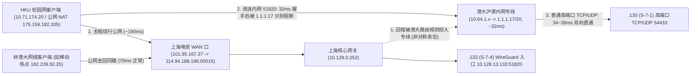

# 网管修复建议与同步检查清单

经过 2026-11-25–26 共 27 轮（T0–T6、E1–E20）测试，已彻底排除客户端本机配置、MTU、命令行实现及本地 VPN/代理软件冲突，并将「HKU 校园网无法直连上海机房」定位到两个清晰的网络层机制：

1. **公网电信入口 `114.94.188.196:50015` 存在多线非对称路由 / uRPF 冲突**：
   - 同一台 Mac 使用中国移动香港手机热点（`182.239.92.25`）时，原版配置直连 `114.94.188.196:50015` 约 **70 ms** 即握手成功并登录 `.130` / `.133`。
   - 但在 HKU 校园网（公网 NAT 出口 `175.159.182.205`）下，去程经公网电信抵达上海（正向 TTL=18 已达上海电信 `101.95.167.37`），而从 `.133` 反向 `mtr` 证实上海核心网关 **`10.128.0.252`** 将所有港大网段（`175.159.182.205`、`147.8.x.x`、`10.71.x.x`）静态/动态路由指向 **港大沪港内网专线（`1.1.1.20 → 10.64.1.153`，~29 ms）**。这导致从电信 WAN 口进入的港大请求触发 uRPF 丢弃，或 `.133` 的回程包被 `10.128.0.252` 导入沪港专线而绕过了电信口 `114.94.188.196` 的状态 NAT 转换，造成去回异路、客户端 0 回包。
2. **沪港内网专线（`10.64.1.x`）直连 `.133:51820` 被中间防火墙按协议特征阻断**：
   - 在 HKU 校园网直接将 WireGuard `Endpoint` 设为内网 `10.128.13.133:51820` 时，**前两包（148 B 请求 + 92 B 响应）在 32.3 ms 内成功完成握手**，但从第 3 个数据包起立即被阻断。
   - 紧接着在纯校园网（无任何 VPN/代理）测试直连 `.130:54433` 普通高端口：**UDP（37.8 ms）与 TCP（单次往返约 34 ms）双向全通**。证实沪港专线物理与路由完全正常，仅路径第 5 跳防火墙（`1.1.1.17` / `1.1.1.20`）限制了 TCP `22` 并对标准 WireGuard 特征执行了 DPI 拦截。



---

## 1. 推荐修复方案（按管理员权限范围任选其一）

### 方案 A：若可协调上海园区上层网关（`10.128.0.252` / 专线防火墙 `1.1.1.17`）

1. **最优解（走 32 ms 沪港校内专线，无需绕公网）**：
   - 在沪港专线防火墙（`1.1.1.17` / `1.1.1.20`）上，对目的地址 `10.128.13.133`、端口 `UDP 51820` 添加**应用识别/协议控制白名单**（豁免 WireGuard 流量阻断）。
   - 放行后，港大本部校园网用户只需提供一个校内版配置：将 `Endpoint` 改为 `10.128.13.133:51820`，并将 `AllowedIPs` 写为 `10.200.0.0/24, 10.128.13.130/32, 10.128.13.131/32, 10.128.13.132/32`（排除 `.133/32` 避免隧道外层包路由回环，访问 `.133` 可用 `10.200.0.1`），即可实现 **32 ms 校内专线直连**。
2. **修复电信公网口 `114.94.188.196:50015` 兼容性**：
   - 在 `10.128.0.252`（或承载 `114.94.188.196` 的边界网关）电信 WAN 接口开启**源进源出（connmark / reply-to 会话粘性回程）**，并对港大公网段（`175.159.176.0/20`、`147.8.0.0/16`）关闭电信 WAN 口的严格逆向路径过滤（strict uRPF），确保从电信公网口打入的握手请求仍从电信公网口 NAT 返回，不被 `1.1.1.20` 校内专线路由抢走。

### 方案 B：若仅管理机房服务器 `.130–.133`（无需申请修改上层网关或防火墙）

由于实测 HKU 校园网直连机房服务器非 `22` 高端口（如 `54433`）的 TCP 与 UDP 均已 **34–38 ms 双向直通**，仅在 `.133`（`S-7-4`）服务器本机即可独立解决：

1. **最简 SSH 跳板方式**：在 `.133` 的 `/etc/ssh/sshd_config` 增加一个高端口监听（如 `Port 54433`，仅允许密钥登录），校内师生通过 `ssh -J user@10.128.13.133:54433 user@10.128.13.130` 即可免 VPN 走 34 ms 沪港专线访问全部四台机器。
2. **保持 WireGuard 全网段体验**：在 `.133` 部署兼容现有 WireGuard 密钥对的包头混淆方案（例如 **AmneziaWG**，或在 `.133` 用 `wstunnel` / `udp2raw` 监听高端口转发至本机 `127.0.0.1:51820`），避开 `1.1.1.17` 对明文 `148B/92B` WireGuard 握手头的特征匹配，即可在校园网跑满 34 ms 专线。

---

## 2. 附：服务端快速验证命令（如需在 `.133` / 网关现场复核）

当前账号 `daqianding` 在 `.130` 属于 `sudo` 组，但在入口 `.133` 无 `sudo` 权限。若网管希望在修改前后现场验证 `.133` 的收包状态，可执行：

### 2.1 查看本测试客户端 peer 状态

```bash
date -Ins
sudo wg show wg0 public-key
for field in endpoints allowed-ips latest-handshakes transfer; do
    printf '\n%s\n' "$field"
    sudo wg show wg0 "$field" |
        awk '$1 == "7qUSYM2GQ4+kFPGXhza1dAAvSGiFtWjE6/oncgG4uhY="'
done
```

### 2.2 抓包对比「公网 50015 不达 / 回程偏转」与「内网 51820 前两包握手成功」

在 `.133` 上监听 `51820`：

```bash
sudo tcpdump -ni any -tttt -vv 'udp port 51820'
```

- 当 HKU 校园网客户端连接公网 `114.94.188.196:50015` 时：若 `.133` 未收到 `175.159.182.x` 的 148 B 包，说明在 `10.128.0.252` 电信口已被 uRPF/ACL 丢弃；若 `.133` 收到并发出 92 B 回复，在 `10.128.0.252` 即可观察到该回复被路由往 `1.1.1.20`（沪港专线）而非电信 WAN 口。
- 当 HKU 校园网客户端连接内网 `10.128.13.133:51820` 时：`.133` 会立即收到来自 `10.71.x.x` / `10.68.x.x` 的第 1 个 148 B 握手包并发出 92 B 响应，而后续客户端发出的 Type 4 数据包在到达 `.133` 前被 `1.1.1.17` 阻断。
