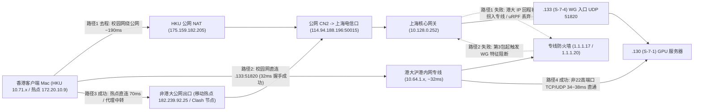

# WireGuard 连接排障报告（2026-11-25–26）

这份记录用于向实验室及园区网管同步：香港大学本部客户端 `10.200.0.5` 在 **HKU 校园网**下通过公网入口 `114.94.188.196:50015` 访问上海实验室服务器时无法完成 WireGuard 握手的完整排查、根因定位与修复建议。

## 核心结论（11 月 26 日晚间最终定位）

**已彻底排除客户端本机配置及 VPN/代理软件干扰，定位到两个独立的服务端/园区网络机制问题（详见[报告第 14 节](REPORT.zh-CN.md#14-最终定位跨网络对照上海多线非对称路由与沪港专线实测)与[网管修复建议](NETADMIN.zh-CN.md)）：**

1. **客户端与密钥完全正常（E17 / E18 跨网与纯净隔离对照）**：
   - **手机热点原生直连秒通**：同一台 Mac 切换至手机热点（`172.20.10.9`，中国移动香港 `182.239.92.25`）时，保持 Clash 开启但 **0 字节经过代理**，原版配置直连 `114.94.188.196:50015` 立即在 **70–110 ms** 内完成握手，直接 SSH 登录 `.130`（`S-7-1`）与 `.133`（`S-7-4`）。
   - **HKU 校园网纯净隔离仍失败**：在 HKU 校园网（`10.71.174.20`，`hku.hk`）关闭全部系统代理、停用 Cisco 网络扩展并暂停 Clash / WARP / GlobalProtect 等全部第三方网络进程后，原生直连发出 6 个 148 B 握手包仍为 **0 回包**。
2. **为什么 HKU 校园网连公网电信口 `114.94.188.196:50015` 零回包（E19：多出口非对称路由 / uRPF 冲突）**：
   - 从 `.133` 反向 `mtr` 证实，上海核心网关 `10.128.0.252` 同时存在三条出口（上海电信公网 `101.95.167.37`、海外出口 `10.4.4.40` / `103.39.110.226`、以及 **港大沪港内网专线 `1.1.1.20 → 10.64.1.153`**）。
   - 凡目的地址属于港大网段（包括 **HKU 校园网公网 NAT 出口 `175.159.182.205`**、`147.8.x.x` 及校内私网 `10.71.x.x`），`10.128.0.252` 均将其强制路由至 **沪港内网专线（`1.1.1.20`，约 29 ms）**。因此 HKU 校园网客户端绕公网（约 190 ms）打入上海电信口 `114.94.188.196:50015` 时，入站包触发电信口逆向路径检查（uRPF）丢弃，或回程包被 `10.128.0.252` 拐入沪港内网专线而未从电信 NAT 口原路返回，导致去回异路、客户端 0 回包；而非港大公网 IP（如移动热点 `182.239.92.25`、Clash 节点）不受该校内专线路由影响，电信口正常对称返回。
3. **为什么直接改走沪港内网专线 `10.128.13.133:51820` 握手后断流（E20：专线防火墙协议识别阻断）**：
   - 在 HKU 校园网直接将 WireGuard `Endpoint` 指向内网 `10.128.13.133:51820`（排除 `.133/32` 避免路由回环）时，去回同走沪港专线（`10.64.1.x`），**前两包（148 B 请求 + 92 B 响应）在 32.3 ms 内成功完成握手**；但第 3 个数据包起立即断流，同五元组后续重握手亦不再响应。
   - 紧接着关闭全部 WireGuard，在纯 HKU 校园网对 `.130:54433` 做普通高端口对照：**直连 UDP（37.8 ms）与 TCP（建连+收发 69.3 ms，单程往返约 34 ms）双向全通**。说明沪港内网专线物理与路由完全畅通，仅路径中间防火墙（第 5 跳 `1.1.1.17` / `1.1.1.20`）封禁了直连 TCP `22` 并对明文 WireGuard 握手特征执行了 DPI 阻断。

## 文档导航

- **[网管修复建议与同步核查清单](NETADMIN.zh-CN.md)**：分别提供「修改上层网关 `10.128.0.252` / 防火墙 `1.1.1.17`」与「仅在 `.133` 服务器本机调整（无需改动上层网络）」两套落地方案。
- **[完整中文报告](REPORT.zh-CN.md)**：整理 T0–T6 与 E1–E20 全部实验、包级时间戳、回程 `mtr` 对比、权限核对（`.130` 有 sudo、`.133` 默认 sudo 拒绝）及证据边界。
- **[可复现的代理连接方法](WORKAROUND.zh-CN.md)**：上层路由修复前，在校园网使用官方 WireGuard 与本地 SOCKS5 UDP 中转的临时方案。
- **[证据来源说明](evidence/README.md)**：区分留存原始日志、对话命令输出转录与环境快照（最新定位证据位于 [`evidence/campus-rootcause-20261126/`](evidence/campus-rootcause-20261126)）。
- **[脱敏客户端配置](config/HKU-SH-Lab.redacted.conf)**：私钥已移除，仅保留排障关联所需的网络地址、端口与公钥。

公开材料不包含任何 WireGuard 私钥、SSH 私钥、sudo 密码、代理订阅或节点凭据。
